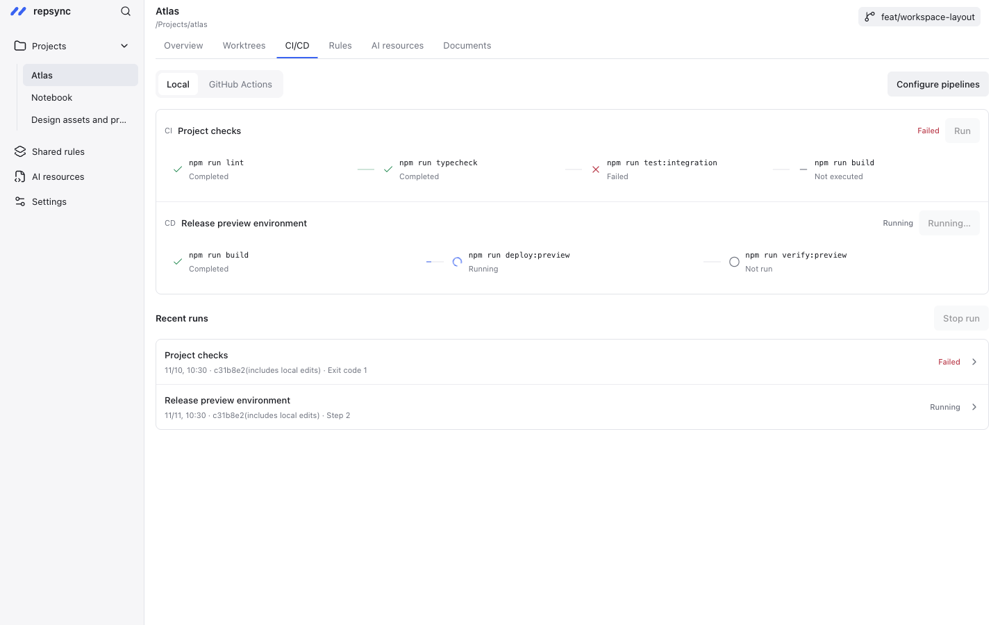

<div align="center">
  
  <h1>repsync</h1>
  <p>A local workspace for your projects, development services, and AI tools.</p>
  <p><a href="README.zh-CN.md">简体中文</a> · <a href="https://dongyu-will.github.io/repsync/">Live demo</a> · <a href="#quick-start">Quick start</a> · <a href="CONTRIBUTING.md">Contributing</a> · <a href="LICENSE">MIT license</a></p>
</div>

Keep project context close at hand: inspect Git worktrees, run existing commands, edit Markdown, and maintain shared engineering rules without switching between repositories.

repsync combines a **Go desktop backend** with **React, TypeScript, Vite, and Tailwind CSS**, connected through **MyGo WebView**. Your AI assistant can use the same local operations through a JSON CLI. No cloud account or hosted backend is required.

**Status:** early development, version 0.1.0. The desktop app is currently validated on macOS Apple Silicon. Other platforms are not yet supported releases. The interface and primary documentation are in English; the detailed Chinese guide is retained for reference.



The [live browser demo](https://dongyu-will.github.io/repsync/) uses isolated fixture data. Desktop operations require the native app.

## What you can do

| Area                   | Capabilities                                                                                                                                                           |
| ---------------------- | ---------------------------------------------------------------------------------------------------------------------------------------------------------------------- |
| Projects               | Register local folders or clone remote repositories; restore the last project and tab; search with ⌘K / Ctrl+K.                                                        |
| Local services         | Start, stop, and restart existing commands; inspect ports and logs; allocate supported development ports and resolve declared service dependencies.                    |
| Pipelines              | Run local CI/CD commands with timeouts, cancellation, logs, and history. Read GitHub Actions runs through your local `gh` login.                                       |
| Git workspace          | Inspect worktrees, branches, and shared stashes. Preview guarded cleanup, retain recovery refs, and restore eligible entries.                                          |
| Documents              | Preview and edit root Markdown files, search document text, and preserve drafts when external edits prevent saving.                                                    |
| Shared rules and files | Preview per-project differences, preserve project-specific content, apply updates with backups, and restore protected snapshots.                                       |
| AI resources           | Inventory local Skills, Codex MCP configuration, and CLI tools. Review project declarations and available usage evidence.                                              |
| Review and memory      | Record checks, delivery stages, handoffs, and sourced project memories. Extract candidate memories from selected local Codex or Claude Code sessions for confirmation. |

A successful command, a recorded check, a Git push, and live acceptance remain separate facts. Usage evidence also distinguishes discovery, loading, execution, and verified outcomes.

## Quick start

Requirements:

- macOS with Apple Silicon for the currently validated desktop build.
- Go **1.27.3 or newer** (the toolchain version is declared in `go.mod`).
- Node.js **22.13 or newer**; Node 24 LTS is recommended, with npm.
- Git. Optional: GitHub CLI (`gh`) for Actions history, `rg` for document review, and Codex / Claude Code CLIs for their respective integrations.

```sh
git clone https://github.com/dongyu-will/repsync.git
cd repsync
npm --prefix frontend ci
go mod download
go tool mygo dev
```

MyGo generates the typed bindings, starts Vite, and opens the desktop app. Add a project using the sidebar, then use Overview, Worktrees, CI/CD, Rules, AI resources, and Documents. Close the app or press Ctrl+C to stop development mode.

### Browser preview

```sh
npm --prefix frontend run dev
```

Open [http://127.0.0.1:5178](http://127.0.0.1:5178). The browser uses isolated fixture data; it does not register local projects, read your repositories, or run desktop commands. Some document drafts can be edited in the browser session. Operations that require disk access are unavailable. Do not run a second Vite instance on the same port.

### Build the desktop app

```sh
go tool mygo build
```

The macOS Apple Silicon output is under `build/darwin-arm64/`. Local builds are ad-hoc signed; distribution signing and notarization are not configured. Build from source for development. See [Releases](https://github.com/dongyu-will/repsync/releases) for any published preview artifacts and their exact limitations.

## AI project configuration (AI 配置项目)

Have your AI assistant inspect the project's existing guides and commands, then maintain `.repsync.json` in its root. Start with actual commands that already work. Registration and configuration do not implicitly start services, run checks, or deploy anything. Manual configuration forms provide a fallback.

```json
{
  "services": [
    {
      "id": "web",
      "name": "Frontend",
      "command": ["npm", "run", "dev", "--", "--port", "{port}"],
      "port": 3000,
      "autoPort": true,
      "url": "http://127.0.0.1:{port}"
    }
  ],
  "pipelines": [
    {
      "id": "check",
      "name": "Project checks",
      "kind": "ci",
      "timeoutSeconds": 600,
      "steps": [["npm", "run", "check"]]
    }
  ]
}
```

Commands are argument arrays, resolved from the project root unless `cwd` is declared. The example assumes your `dev` script accepts `--port`; adapt it to your project's tools. Use `fixedPort` when a port must stay fixed. `envFrom` can reference declared service endpoints. Never commit credentials in configuration; use the local environment or existing credential stores.

Shared rules use a managed block inside `AGENTS.md`; content outside that block stays project-owned. Shared files have explicit source and destination registrations. Preview before applying; changed sources, targets, or configuration invalidate old previews. Existing differences must be resolved before an update can overwrite them.

The [detailed guide in Chinese](README.zh-CN.md) covers configuration fields, limits, recovery, review declarations, and the full CLI reference. [PRODUCT.md](PRODUCT.md) records product decisions and planned work; [DESIGN.md](DESIGN.md) records interface conventions. Those internal design documents currently remain in Chinese. Planned behavior in them is not a claim of released functionality.

## CLI

The desktop app owns the local control service. The CLI uses the same project registry and operations through a user-only Unix socket.

```sh
go build -o bin/repsync ./cmd/repsync
./bin/repsync --help

# A development CLI needs a packaged desktop executable to launch the app.
export REPSYNC_APP="$PWD/build/darwin-arm64/repsync.app/Contents/MacOS/repsync"
./bin/repsync open
./bin/repsync add /absolute/path/to/project
./bin/repsync projects
./bin/repsync doctor /absolute/path/to/project
./bin/repsync start --dry-run /absolute/path/to/project
./bin/repsync start --wait --timeout 30s /absolute/path/to/project
./bin/repsync status /absolute/path/to/project
```

Most CLI operations return JSON with `ok`, `data`, and an `error` on failure. Exit codes are 0 for success, 1 for operational failure, and 2 for invalid arguments. `start --wait` checks TCP readiness for declared ports; it does not prove application health. Commands without declared ports remain explicitly unchecked.

Use the returned `runId` when reading logs or stopping a service:

```sh
repsync logs /absolute/path/to/project web RUN_ID
repsync stop /absolute/path/to/project web RUN_ID
repsync stop-projects /absolute/path/to/project

repsync pipelines /absolute/path/to/project
repsync run --wait --timeout 10m /absolute/path/to/project CHECK_ID CONFIG_VERSION
repsync runs /absolute/path/to/project
```

Read pipeline IDs and configuration versions before running; do not guess a release command. See `--help` for shared rules, worktrees, stashes, project memory, and review commands. CLI-driven operations remain subject to the same snapshot and active-operation protections as the desktop UI.

## Local data and privacy

- On macOS, project registration and local history live under `~/Library/Application Support/repsync/`. The control socket has user-only permissions; there is no network control listener.
- Project configuration lives in the project's `.repsync.json`. Explicit rule updates, shared-file updates, document saves, and memory integrations may write their documented target files; inventory does not automatically apply changes.
- Service commands and pipelines execute locally with your account's permissions. Review commands before running them. Only app-owned processes can be stopped through its service controls.
- Session inventory is local and bounded. **Memory extraction sends selected user messages from completed turns to the chosen AI CLI and its configured provider.** Extracted records remain pending until confirmed. Do not select sessions containing material you do not want that provider to process.
- Browser preview data and local-storage keys are isolated from registered desktop projects.

Removing a project registration preserves its directory, logs, and backups. Cleanup never deletes remote branches. Modified, ignored, active, protected, or uncertain worktrees are retained; Codex-managed worktrees are managed through their owning chats. Stash apply preserves the original stash and reports conflicts without resetting the worktree.

## Development and validation

```sh
go tool mygo generate
sh tools/shared/check-go-format.sh cmd internal
npm --prefix frontend run check
go vet ./...
go test -tags=integration -race ./internal/workspace ./internal/control
npm --prefix frontend run build
go tool mygo build
```

Tests use temporary directories and temporary Git repositories. TypeScript and ESLint run through `check`; `build` produces the frontend assets. GitHub CI runs the format, frontend, vet, integration, and frontend build checks on macOS. Desktop packaging is verified separately.

Format only the files you change with `gofmt` or the project's Prettier. `frontend/src/mygo.ts` is generated; update Go bindings and regenerate it instead of editing it manually.

For interface changes, check **960×640**, **760×500**, and **1440×900**, including long paths, errors, empty states, keyboard navigation, and disabled desktop actions in the browser preview. English is the default interface language; user documents, project names, logs, and AI-generated content retain their original language.

Release history is recorded in [CHANGELOG.md](CHANGELOG.md).

## Roadmap and limits

Current priorities are dependable local operations, clear execution evidence, and reusable project resources. Built-in Git commit/pull/push, worktree creation/switching, automatic pipeline scheduling, cross-project batch upgrades, cloud sync, and a general plugin system are not implemented. repsync does not replace your repository's release gates or prove production state from a local result.

There is no automatic desktop update channel or verified Windows/Linux distribution yet. Please report reproducible problems before relying on preview builds for critical workflows.

## Contributing

Bug reports, focused improvements, and documentation corrections are welcome. Read [CONTRIBUTING.md](CONTRIBUTING.md) for setup, checks, and pull request expectations, and [SECURITY.md](SECURITY.md) for reporting sensitive issues. Use English for shared documentation and new interface copy when possible. Keep project-specific rules with their project rather than copying them into shared defaults.

## License

[MIT](LICENSE). Third-party dependencies retain their own licenses; see [THIRD_PARTY_NOTICES.md](THIRD_PARTY_NOTICES.md).
