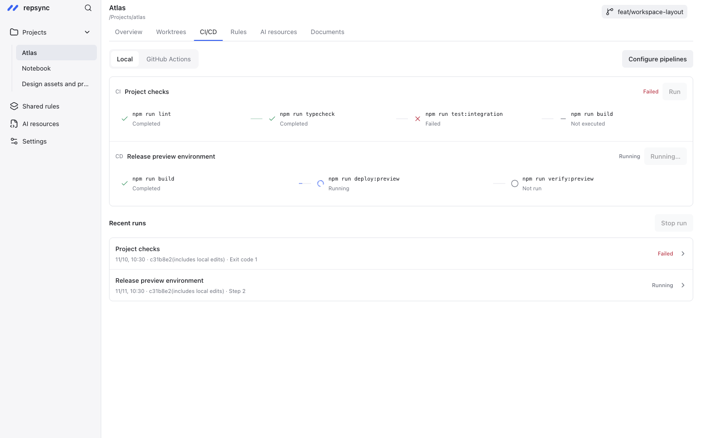

# repsync

[English](README.md) · [在线演示](https://dongyu-will.github.io/repsync/) · [下载](https://github.com/dongyu-will/repsync/releases)



## 功能

- 登记本地目录、克隆仓库，通过 ⌘K / Ctrl+K 切换项目。
- 管理开发服务、端口、CI/CD、日志与 GitHub Actions 运行记录。
- 查看工作树、分支和 Stash，预览清理并恢复。
- 预览、编辑与搜索项目 Markdown 文档。
- 维护公共规则、共享文件、Skill 和 Codex MCP 配置。
- 保存有来源的项目记忆、检查记录与任务交接。

配置通过各页的「交给 AI 配置」生成带项目上下文的指令，复制到现有 AI 聊天处理；服务、流水线、规则及资源不再要求逐项填表。复制不会自动执行，完成后返回应用刷新。

## 安装

下载 [macOS Apple Silicon 预览版](https://github.com/dongyu-will/repsync/releases)，打开 DMG 后将 `repsync.app` 移到“应用程序”。预览版使用 ad-hoc 签名，尚未公证。

从 0.1.2 起，桌面版在启动后和每天自动检查签名更新，也可通过「设置 → 检查更新」或应用菜单手动检查。在更新窗口安装，退出后替换原来的应用并可重新启动；可在窗口中选择以后自动下载安装。项目登记、备份和历史记录保留，开发版不执行自更新。

0.1.2 之前的版本需先手动替换一次 `/Applications/repsync.app` 才能启用更新器。只保留一份正式版，历史版本保留安装包，不长期保留解压的应用。发布配置与限制见[桌面更新](docs/usage.md#desktop-updates)。

从源码启动需要 Go 1.27.4+、Node.js 22.13+（建议 Node 24）、npm 和 Git：

```sh
git clone https://github.com/dongyu-will/repsync.git
cd repsync
npm --prefix frontend ci
go mod download
go tool mygo dev
```

启动后从侧栏添加项目。项目页签保留「启动项目 / 项目规范 / CI/CD / 分支与工作区 / 待办与交接」；「项目地图」和项目「AI 资源」归入默认收起的「实用功能」，手动选择后打开。文档查看与编辑并入项目规范，命令详情并入启动项目；公共更新与共享文件统一从左侧共享规范进入。`go tool mygo build` 生成的桌面应用位于 `build/darwin-arm64/`。

浏览器预览：运行 `npm --prefix frontend run dev`，打开 [localhost:5178](http://127.0.0.1:5178)。浏览器使用独立示例项目，本机文件和进程操作在桌面应用中使用。

## 文档

- [配置与 CLI 指南（英文）](docs/usage.md)
- [详细操作指南（中文）](docs/guide.zh-CN.md)
- [开发与检查命令](README.md#development-and-validation)
- [参与贡献](CONTRIBUTING.md) · [安全问题](SECURITY.md) · [更新记录](CHANGELOG.md)
- [产品需求](PRODUCT.md) · [界面基线](DESIGN.md) · [Agent 规则](AGENTS.md)

## 许可证

[MIT](LICENSE)。依赖许可证见 [第三方声明](THIRD_PARTY_NOTICES.md)。
